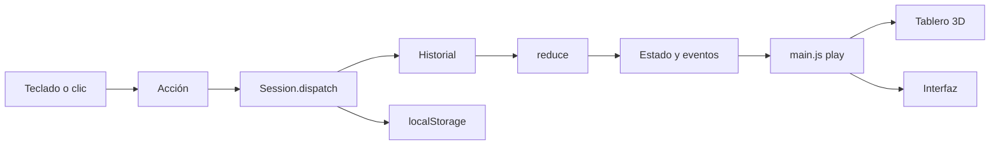

# Especificación técnica

## Resumen

- JavaScript sin framework + [Three.js](https://threejs.org) r170 para el tablero 3D.
- esbuild empaqueta todo en **un solo archivo** `jugar/JUGAR.html` (unos 720 KB): JavaScript, CSS y tipografías en base64. No hay imágenes ni sonidos externos: texturas y sonidos se generan por código.
- Abre desde `file://` con doble clic, sin servidor ni internet.
- Navegadores: Chrome/Edge 100+, Safari 15+, Firefox 100+. Requiere WebGL 2.

## Estructura

```
src/
  engine/        Motor de juego puro (sin DOM): se prueba con node --test
    board.js       Carriles, casillas, cruces
    rules.js       Reglas provisorias y valores por defecto
    roster.js      Equipos y vehículos por defecto
    reducer.js     Estado = reducir(historial de acciones)
    session.js     Historial, deshacer/rehacer, saltos, guardado, importar/exportar
    describe.js    Textos del historial en español
  content/deck.js  Cartas genéricas y carga de contenido real (JSON)
  scene/         Tablero 3D
    layout.js      Recorrido, posición de cada casilla, tamaños
    board.js       Mesa, tablero, carriles, cruces, Palacio, Obelisco, paisaje
    vehicles.js    Las 6 fichas
    spinner.js     Ruleta
    stage.js       Renderizador, luces, cámara, animaciones
    textures.js    Texturas procedurales (madera, paño, etiquetas)
    merge.js       Une geometría estática para reducir llamadas de dibujo
    palette.js     Colores UBA y de casillas
  ui/            Interfaz HTML sobre el tablero
    hud.js         Barra superior, leyenda, fichas de equipos, avisos
    cards.js       Cartas y carta de choque
    config.js      Panel de configuración
    overlays.js    Pantalla de inicio y ganador
    sound.js       Efectos de sonido sintetizados (WebAudio)
  main.js        Orquestador: acciones, animaciones, teclado
  styles.css     Estilos y tokens UBA
  index.html     Plantilla
build.mjs        Genera jugar/JUGAR.html
tests/           Pruebas del motor
```

## Motor de juego

El estado de la partida nunca se guarda directamente: se recalcula.

```
estado = historial.reduce(reduce, createGame(equipos, reglas))
```

Cada acción lleva todos sus datos, incluido el resultado de la ruleta, así que repetir el historial siempre da el mismo estado. Esto es lo que hace confiables deshacer, rehacer, "ir a la jugada N", el reinicio y la recuperación tras recargar.



### Acciones

| Acción | Datos | Efecto |
| --- | --- | --- |
| `SPIN` | `value` | Avanza al equipo de turno y resuelve la casilla |
| `VERDICT` | `result`: `ok`, `fail` o `void` | Resuelve la carta abierta |
| `COLLISION` | `winner`: id o `null` | Resuelve el choque |
| `RULES` | `rules` (parcial) | Cambia reglas desde ese punto |
| `SET_POS` | `team`, `pos` | Ajuste manual, no activa la casilla |
| `SET_TURN` | `team` | Da el turno a un equipo |
| `PASS` | | Pasa el turno (cierra una carta sin efecto) |

Una acción que no corresponde a la fase actual se ignora y no se registra.

### Fases

`spin` → (`card` | `collision`) → `spin` del siguiente equipo … → `finished`.

### Eventos

Cada acción produce una lista de eventos (`spin`, `move`, `land`, `shift`, `collision`, `card`, `extraSpin`, `skipNext`, `skipped`, `finish`, `turn`, …). El orquestador los reproduce en orden como animaciones y avisos. Deshacer o saltar no anima: las fichas se reubican directamente.

## Guardado

- Clave `jurisprudencia-en-ruta.session.v1` en `localStorage`: `{ v, roster, rules, history, redo, settings, savedAt }`. Se escribe en cada acción.
- Clave `jurisprudencia-en-ruta.deck.v1`: contenido jurídico cargado.
- En Chrome y Edge, `localStorage` de archivos `file://` se comparte entre archivos locales; en Safari depende de la ruta del archivo. Si se mueve la carpeta, se puede perder la partida guardada: para cambiar de computadora o carpeta, usar Exportar / Importar partida.
- Si el almacenamiento está bloqueado (modo privado), el juego funciona igual pero sin guardado.

Si cambia el formato, subir `SESSION_VERSION` en `session.js`: las partidas viejas se descartan en vez de romper.

## Gráficos

- Renderizado PBR con mapeo de tonos ACES, entorno `RoomEnvironment`, sombra suave de una luz principal, luz de relleno y foco cenital.
- Materiales tipo plástico con barniz (clearcoat) para fichas y casillas.
- La geometría estática se une por material (`merge.js`): unas 330 llamadas de dibujo por cuadro contando el pase de sombras (eran unas 750 sin unir).
- Calidad (Configuración > Presentación): **Alta** (resolución 2×, sombras 4096), **Media** (1,25×, 2048), **Baja** (1×, sin sombras, menos árboles). Además, si el equipo no sostiene unos 40 cuadros por segundo, la resolución baja sola una vez.

## Pruebas

```bash
npm test
```

Cubren: composición de carriles, paradas en cruces, choques y penalidades, cartas y efectos, ganador, repetición determinista, deshacer/rehacer/saltar/reiniciar, recarga desde el almacenamiento, exportar/importar e historial.

Verificación manual antes de cada presentación: ver [MANTENIMIENTO.md](MANTENIMIENTO.md#checklist-antes-de-presentar).

## Build

`npm run build` ejecuta `build.mjs`:

1. esbuild empaqueta `src/main.js` (IIFE, minificado).
2. Las tipografías Bitter (`@fontsource/bitter`) se insertan en el CSS como data URL.
3. CSS y JS se insertan en `src/index.html` y se escribe `jugar/JUGAR.html`.

`npm run dev` recompila al guardar. Para probar en un navegador con herramientas de desarrollo, servir la carpeta `jugar/` (por ejemplo `python3 -m http.server`) o abrir el archivo directamente.

En la consola del navegador, `window.__juego` expone la aplicación para depurar (`__juego.session.state`, `__juego.act({...})`).
