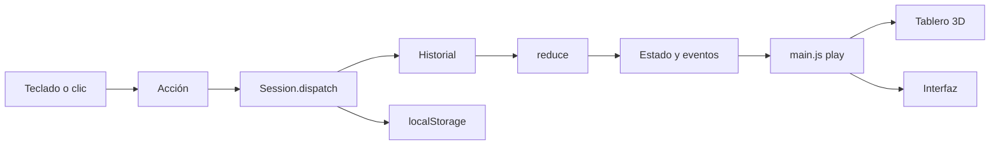

# Especificación técnica

## Resumen

- JavaScript sin framework + [Three.js](https://threejs.org) r170 para el tablero 3D.
- esbuild empaqueta todo en **un solo archivo** `jugar/JUGAR.html` (unos 3 MB): JavaScript, CSS, tipografías y el HDRI de iluminación en base64. No hay archivos externos: las demás texturas y los sonidos se generan por código.
- Abre desde `file://` con doble clic, sin servidor ni internet.
- Navegadores: Chrome/Edge 100+, Safari 15+, Firefox 100+. Requiere WebGL 2.

## Estructura

```
src/
  engine/        Motor de juego puro (sin DOM): se prueba con node --test
    board.js       Rutas, casillas, rotondas (quién se cruza con quién)
    rules.js       Reglas provisorias y valores por defecto
    roster.js      Equipos y vehículos por defecto
    reducer.js     Estado = reducir(historial de acciones)
    session.js     Historial, deshacer/rehacer, saltos, guardado, importar/exportar
    describe.js    Textos del historial en español
  content/deck.js  Cartas genéricas y carga de contenido real (JSON)
  scene/         Tablero 3D
    layout.js      Geometría de las rutas trenzadas, casillas, centro de cada rotonda
    roads.js       Rutas, casillas, rotondas, salidas, avenida Meta, río y puentes (geometría)
    landmarks.js   Monumentos de cada barrio y sus nombres
    text3d.js      Letras nítidas: atlas de glifos Bitter, texto a lo largo de una curva
    space.js       Río, cartel, plaza y la prueba "¿hay lugar libre acá?"
    printed.js     Fondo impreso (canvas): regiones, plaza, viñeta, pliegue, borde
    board.js       Mesa, marco, Palacio, edificios, semáforos, árboles, mazos
    vehicles.js    Las 6 fichas
    spinner.js     Ruleta sobre un pedestal bajo
    stage.js       Renderizador, luces, cámara, animaciones
    textures.js    Texturas procedurales (madera, ruleta, mazos, carteles)
    merge.js       Une geometría estática para reducir llamadas de dibujo
    palette.js     Colores UBA y de casillas
  ui/            Interfaz HTML sobre el tablero
    hud.js         Barra superior, leyenda, fichas de equipos, avisos
    cards.js       Cartas y carta de choque
    config.js      Panel de configuración
    overlays.js    Pantalla de inicio y ganador
    sound.js       Efectos de sonido sintetizados (WebAudio)
  main.js        Orquestador: acciones, animaciones, teclado
  styles.css     Estilos y tokens UBA
  index.html     Plantilla
build.mjs        Genera jugar/JUGAR.html
tests/           Pruebas del motor
```

## Motor de juego

El estado de la partida nunca se guarda directamente: se recalcula.

```
estado = historial.reduce(reduce, createGame(equipos, reglas))
```

Cada acción lleva todos sus datos, incluido el resultado de la ruleta, así que repetir el historial siempre da el mismo estado. Esto es lo que hace confiables deshacer, rehacer, "ir a la jugada N", el reinicio y la recuperación tras recargar.



### Acciones

| Acción | Datos | Efecto |
| --- | --- | --- |
| `SPIN` | `value` | Avanza al equipo de turno y resuelve la casilla |
| `VERDICT` | `result`: `ok`, `fail` o `void` | Resuelve la carta abierta |
| `COLLISION` | `winner`: id o `null` | Resuelve el choque |
| `RULES` | `rules` (parcial) | Cambia reglas desde ese punto |
| `SET_POS` | `team`, `pos` | Ajuste manual, no activa la casilla |
| `SET_TURN` | `team` | Da el turno a un equipo |
| `PASS` | | Pasa el turno (cierra una carta sin efecto) |

Una acción que no corresponde a la fase actual se ignora y no se registra.

### Rotondas

`engine/board.js` arma las rutas como una trenza. Las 6 rutas tienen una "posición" de columna (0 a 5, de izquierda a derecha). En cada nivel de cruce (casillas 8, 17 y 25) las posiciones se agrupan (`LEVEL_GROUPS`: pares, tríos, pares) y cada grupo invierte su orden al pasar por la rotonda. Así cada ruta cruza a rivales distintos.

- `CROSSINGS`: `{ id, level, index, lanes }` para las 8 rotondas.
- `crossingAt(lane, pos)`: id de la rotonda o `null`. El choque se detecta comparando ids, no números de casilla: dos equipos en la casilla 8 de rutas distintas no chocan.
- `pending.cruce` y el evento `collision` llevan el id de la rotonda (es el número impreso en el tablero).

`scene/layout.js` convierte esa trenza en curvas:

- Cada ruta tiene su columna entre rotondas. Un tramo que necesita más largo para sus casillas serpentea alrededor de su columna (`m` zigzags de ancho `a`).
- `designAll()` elige, tramo por tramo, el serpenteo con las curvas más abiertas que deja al menos `MIN_SPACING` entre casillas sin acercarse a rutas ya trazadas, a otras rotondas, a las salidas, a la ruleta ni al borde. En cada franja eligen primero las rutas que más largo necesitan.
- `filletPath()` reemplaza cada esquina por un arco de radio hasta `FILLET_RADIUS`. Junto a cada ancla (salida, rotonda, meta) queda un tramo recto: las rutas entran a las rotondas en línea radial y llegan a la Meta perpendiculares.
- `warp()` deforma el plano muy suavemente (una deformación fuerte aplastaría las curvas) y cerca de la Meta inclina las rutas para que lleguen perpendiculares a la avenida curva.

`tests/layout.test.mjs` verifica que las rutas solo se tocan en sus rotondas, que no pisan la ruleta, que no salen del tablero y que ninguna casilla cae en una rotonda, una salida o la Meta.

### Fases

`spin` → (`card` | `collision`) → `spin` del siguiente equipo … → `finished`.

### Eventos

Cada acción produce una lista de eventos (`spin`, `move`, `land`, `shift`, `collision`, `card`, `extraSpin`, `skipNext`, `skipped`, `finish`, `turn`, …). El orquestador los reproduce en orden como animaciones y avisos. Deshacer o saltar no anima: las fichas se reubican directamente.

## Guardado

- Clave `jurisprudencia-en-ruta.session.v3` en `localStorage`: `{ v, roster, rules, history, redo, settings, savedAt }`. Se escribe en cada acción.
- Clave `jurisprudencia-en-ruta.deck.v1`: contenido jurídico cargado.
- En Chrome y Edge, `localStorage` de archivos `file://` se comparte entre archivos locales; en Safari depende de la ruta del archivo. Si se mueve la carpeta, se puede perder la partida guardada: para cambiar de computadora o carpeta, usar Exportar / Importar partida.
- Si el almacenamiento está bloqueado (modo privado), el juego funciona igual pero sin guardado.

Si cambia el formato, subir `SESSION_VERSION` en `session.js`: las partidas viejas se descartan en vez de romper.

## Gráficos

- Renderizado PBR con mapeo de tonos ACES, iluminación de entorno de un HDRI de estudio (`assets/studio.hdr`, "Studio Small 09" 1K, CC0 de Poly Haven, va embebido en el HTML), sombra suave de una luz principal, luz de relleno y foco cenital.
- Posprocesado (`post.js`, Alta y Media): oclusión ambiental GTAO a media resolución (sombras de contacto donde fichas y edificios tocan el tablero), un brillo leve en dorados y faroles y SMAA como antialiasing. No hay desenfoque (tilt-shift ni profundidad de campo): en el proyector cada casilla tiene que leerse nítida. El buffer intermedio no usa multisampling: en GPUs de notebook costaba más que todos los efectos juntos.
- Todo lo que tiene que verse nítido de cerca es geometría, no textura: rutas (cintas a lo largo de la curva), casillas (bloques curvos), rotondas, salidas, avenida Meta, río y puentes (`roads.js`). Los textos del tablero se arman con un atlas de glifos y siguen cualquier curva (`text3d.js`), así "RIACHUELO" sigue al río y "META · PALACIO DE JUSTICIA" a la avenida.
- Debajo queda un solo plano con el fondo impreso (`printed.js`, 40 píxeles por unidad): regiones de color difuminadas, plaza, viñeta, pliegue y borde. Nada ahí necesita bordes duros, por eso no se pixela. El grano del papel es una textura chica repetida como relieve.
- Al cambiar el color de un equipo solo cambia el color del material de su borde de ruta y se rehacen los nombres de las salidas (con 120 ms de espera para no rehacerlos en cada movimiento del selector).
- Materiales tipo plástico con barniz (clearcoat) para fichas, casillas, monumentos y edificios.
- La geometría estática se une por material (`merge.js`): unas 170 llamadas de dibujo por cuadro contando el pase de sombras.
- Calidad (Configuración > Presentación): **Alta** (resolución hasta 2×, la nativa de una pantalla Retina, sombras 4096, posprocesado completo), **Media** (hasta 1,5×, 2048, posprocesado completo), **Baja** (1×, sin sombras ni posprocesado, menos árboles). Por debajo de la resolución nativa la imagen se estira y el tablero se ve fuera de foco. En una Radeon Pro 5500M, con la ventana a 1920×1080 en la pantalla Retina, Alta a 2× cuesta unos 27 ms de GPU por cuadro; en un proyector de 1920×1080 (1×) cuesta cerca de un cuarto.
- ¿Por qué no un motor nativo? Se probó Godot 4.7 en la MacBook Pro de la presentación (Intel + Radeon Pro 5500M). En esa Mac Godot no tiene Metal nativo (solo en Apple Silicon) y pasa por MoltenVK: el renderizador con efectos avanzados no supera unos 25 cuadros por segundo ni con la escena casi vacía, y el renderizador rápido (OpenGL) tiene las mismas capacidades que WebGL. Three.js en Chrome dibuja el tablero completo con efectos en unos 11 ms. En una Mac Apple Silicon convendría volver a evaluarlo.
- Si un cuadro le cuesta a la GPU más de 22 ms (`gpu-timer.js`, medido con `EXT_disjoint_timer_query_webgl2`), cada 2 segundos se resigna algo: primero la oclusión ambiental y después resolución, de a 0,25× hasta 1×. Se mide el tiempo de GPU y no los cuadros por segundo porque el navegador limita los cuadros por segundo en pestañas de fondo y vistas embebidas aunque la GPU esté libre; eso hacía bajar la calidad sin motivo. Sin esa extensión se usa la tasa de cuadros (umbral 45). En la MacBook Pro de la presentación, en su pantalla, queda en 1,75× sin oclusión ambiental.

## Pruebas

```bash
npm test
```

Cubren: composición de rutas, paradas en cruces, choques por rotonda (incluida la de tres rutas), geometría del tablero, penalidades, cartas y efectos, ganador, repetición determinista, deshacer/rehacer/saltar/reiniciar, recarga desde el almacenamiento, exportar/importar e historial.

Verificación manual antes de cada presentación: ver [MANTENIMIENTO.md](MANTENIMIENTO.md#checklist-antes-de-presentar).

## Build

`npm run build` ejecuta `build.mjs`:

1. esbuild empaqueta `src/main.js` (IIFE, minificado).
2. Las tipografías Bitter (`@fontsource/bitter`) se insertan en el CSS como data URL.
3. CSS y JS se insertan en `src/index.html` y se escribe `jugar/JUGAR.html`.

`npm run dev` recompila al guardar. Para probar en un navegador con herramientas de desarrollo, servir la carpeta `jugar/` (por ejemplo `python3 -m http.server`) o abrir el archivo directamente.

En la consola del navegador, `window.__juego` expone la aplicación para depurar (`__juego.session.state`, `__juego.act({...})`).
